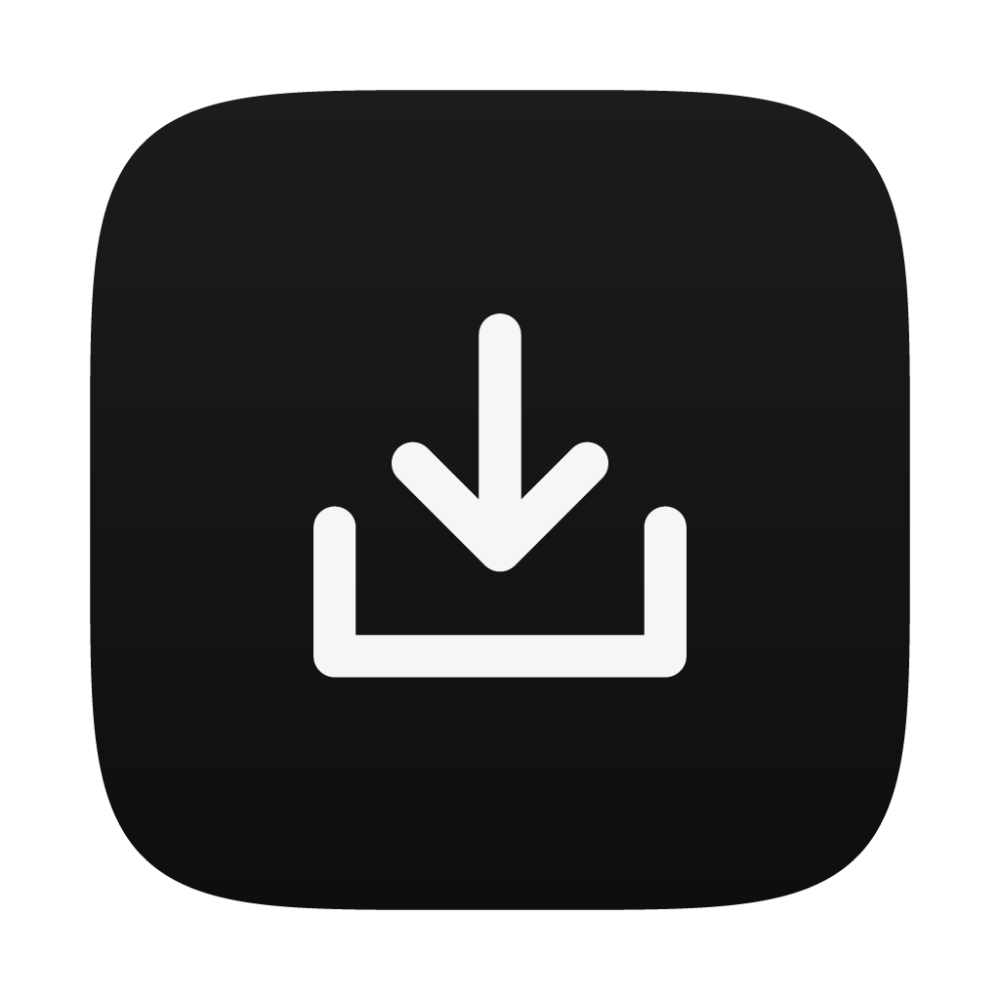
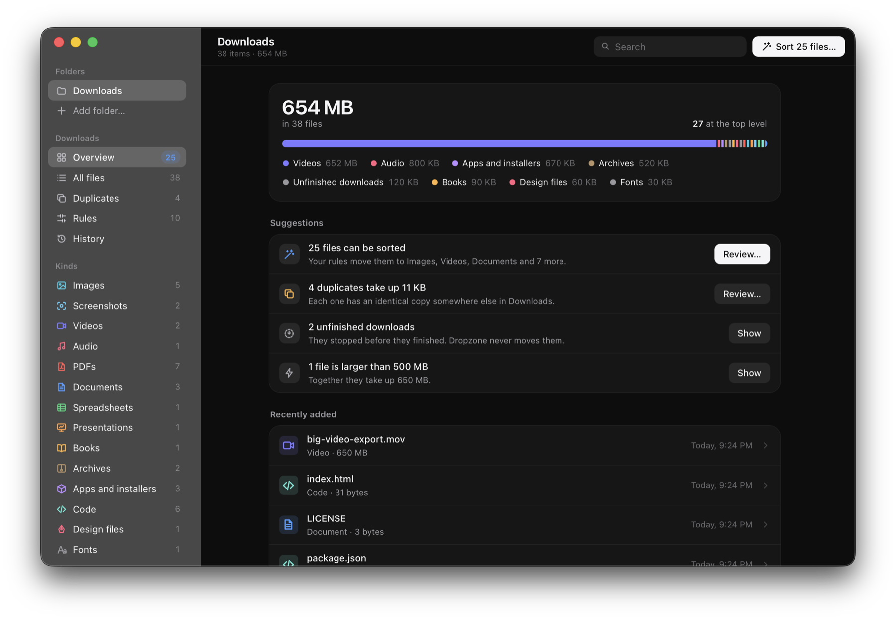

<p align="center">
  
</p>

<h1 align="center">Dropzone</h1>

<p align="center">
  A calm macOS app that brings order to your Downloads and other folders,<br>
  with rules you can preview and changes you can undo.
</p>

<p align="center">
  <a href="https://github.com/liwidale/dropzone/releases/latest"></a>
  <a href="https://github.com/liwidale/dropzone/actions/workflows/ci.yml"></a>
  
  <a href="LICENSE"></a>
</p>

<p align="center">
  
</p>

<p align="center"><sub>Captured from the app running on a sample Downloads folder.</sub></p>

Downloads folders fill up with installers, screenshots, PDFs and archives until nothing is easy to find. Dropzone recognizes what each file is, suggests where it belongs and moves it only after you have seen the plan. Every change goes into History, so you can put things back at any time. Everything happens on your Mac.

## Contents

- [Download](#download)
- [What you get](#what-you-get)
- [Getting started](#getting-started)
- [Everyday use](#everyday-use)
- [Keyboard shortcuts](#keyboard-shortcuts)
- [Rules](#rules)
- [Privacy](#privacy)
- [Where Dropzone keeps its files](#where-dropzone-keeps-its-files)
- [Troubleshooting](#troubleshooting)
- [Building from source](#building-from-source)
- [How it works](#how-it-works)
- [Project structure](#project-structure)
- [Contributing](#contributing)
- [License](#license)

## Download

**[Get the latest version](https://github.com/liwidale/dropzone/releases/latest)**

| | File | Works on |
| --- | --- | --- |
| macOS | `Dropzone-<version>-mac.dmg` | macOS 12 or later, Apple silicon and Intel |
| macOS | `Dropzone-<version>-mac.zip` | the same app as a ZIP archive |

Each release also lists `SHA256SUMS.txt` so you can check the download.

## What you get

- **Sort with rules you control.** Ten starting rules sort loose files by kind into folders like Images, Documents and Installers. Edit them, add your own and drag them into the order you want.
- **Review before anything moves.** Sorting opens a preview grouped by destination. Leave out any file you like. When a name is already taken, the file gets a number, so nothing is ever replaced.
- **Undo anything.** Every change is recorded in History. Undo puts files back where they were, including files moved to the Trash, and says plainly when something can no longer be restored.
- **Find exact duplicates.** Dropzone compares file contents, so copies with different names are found too. You choose which copy stays, and one always does.
- **See what you have.** Files are recognized by their contents as well as their names, including screenshots, unfinished downloads and files without an extension. The site a file came from is shown when macOS recorded it.
- **Code projects stay intact.** Folders with a `.git` folder, `package.json`, `Cargo.toml` or another project file are protected. Sorting and duplicate cleanup never touch them, and moving their files by hand asks first.
- **Sort new files automatically.** Turn it on for a folder, and files that arrive from then on are sorted as soon as they stop changing. Rules that move files to the Trash only run when you sort by hand.
- **Find files fast.** Search by name, kind or source, filter by kind, and open the inspector for details about any file.
- **Feels at home on a Mac.** A native menu bar, keyboard shortcuts, light and dark appearance and a translucent sidebar.

## Getting started

1. **Install Dropzone.** Open the DMG and drag Dropzone to Applications.
2. **Open it the first time.** Dropzone isn't signed by Apple yet, so macOS asks once. Right-click Dropzone in Applications and choose **Open**. If macOS still refuses, run this in Terminal:

   ```bash
   xattr -dr com.apple.quarantine /Applications/Dropzone.app
   ```

3. **Choose a folder.** Click **Use Downloads folder**, or choose any other folder. macOS asks for permission to let Dropzone read it.
4. **Review and sort.** The overview shows what is in the folder and what can be sorted. Click **Review**, untick anything you want to keep where it is and click **Sort**.

## Everyday use

- **Overview** shows how much space each kind of file takes and suggests what to do next: files to sort, duplicates, installers you no longer need, unfinished downloads and very large files.
- **All files** and the kinds in the sidebar list every file. Switch between everything and the top level only, sort by any column and select files to open, show in Finder, move or trash.
- **Duplicates** groups identical files. Mark which copies stay and move the rest to the Trash after a final review.
- **Rules** decide where files go. Turn them on and off, edit them or change their order.
- **History** lists every change with an **Undo** button.
- **Add more folders** with **Add folder** in the sidebar, or drop a folder onto the window.

## Keyboard shortcuts

| Action | Shortcut |
| --- | --- |
| Add a folder | `⌘O` |
| Sort files | `⇧⌘S` |
| Undo the last change | `⌘Z` |
| Search | `⌘F` |
| Refresh | `⌘R` |
| Overview, All files, Duplicates, Rules, History | `⌘1` to `⌘5` |
| Show or hide the inspector | `⌥⌘I` |
| Settings | `⌘,` |

In the file list: `↑` `↓` move the selection, `⇧` extends it, `Return` or `⌘↓` opens the selected files, `⌘⌫` moves them to the Trash and `Esc` clears the selection.

## Rules

A rule has one or more conditions and an action. A file must match every condition.

| Condition | Example |
| --- | --- |
| Kind | Images, PDFs, apps and installers |
| Extension | `pdf, docx` |
| Name | `invoice`, or a pattern like `*.tmp` |
| Downloaded from | `github.com` |
| Date added | more than 30 days ago |
| Size | larger than 500 MB |

The action moves matching files to a folder inside the one you are sorting, for example `Invoices` or `Work/Invoices`, or to any folder you choose. Files can be grouped into subfolders by year or by month. A rule can also move files to the Trash.

Rules run from top to bottom, and the first rule that matches a file decides where it goes. Only files at the top level of a folder are sorted. Files already in subfolders, unfinished downloads and files inside code projects stay where they are.

## Privacy

- Everything stays on your Mac. Dropzone has no account, sends no analytics and never connects to the internet.
- It reads only the folders you add. Moves happen with the same rights you have in Finder.
- File contents are read only to recognize file types and to compare possible duplicates.
- You can clear History at any time in **Settings**.

## Where Dropzone keeps its files

| What | Where |
| --- | --- |
| Folders, rules and settings | `~/Library/Application Support/com.liwidale.dropzone/config.json` |
| History of changes | `~/Library/Application Support/com.liwidale.dropzone/history.json` |
| Changes in progress | `journal.json` and `journal.log` in the same folder, removed when a change finishes |

## Troubleshooting

**"Dropzone can't open Downloads".**
macOS needs your permission first. Click **Open System Settings**, go to **Privacy & Security → Files and Folders** and allow Dropzone to read the folder. Then click **Try again**.

**A folder isn't available.**
It may have been renamed, moved or be on a drive that isn't connected. Click **Locate** to point Dropzone to its new place, or remove it from the sidebar.

**Sorting is paused for a folder.**
The folder contains a project file such as `package.json`, so Dropzone treats it as a code project. If it isn't one, turn on **Sort this folder anyway** in **Rules**.

**Undo couldn't put a file back.**
History shows the reason for each file. A file moved to the Trash can't come back after the Trash was emptied, and a file that was moved or deleted after sorting stays where it is now.

**Dropzone closed while it was sorting.**
On the next launch it finishes the record of what happened and offers to undo the part that was done. Files it hadn't reached yet were not touched.

## Building from source

### Requirements

- macOS 12 or later with the Xcode command line tools (`xcode-select --install`)
- [Node.js](https://nodejs.org/) 24 or later, with npm
- [Rust](https://rustup.rs/) stable

### Run it

```bash
git clone https://github.com/liwidale/dropzone.git
cd dropzone
npm ci
npm run dev
```

### Useful scripts

| Command | What it does |
| --- | --- |
| `npm run dev` | Run the app with live reload |
| `npm run build` | Build `Dropzone.app` and a DMG into `src-tauri/target/release/bundle` |
| `npm test` | Run the Rust tests |
| `npm run lint` | Lint the TypeScript |
| `npm run typecheck` | Check the TypeScript types |
| `npm run format` | Format the TypeScript and CSS |
| `npm run icons` | Regenerate the app icons from code |

### Releases

Every push to `main` runs `.github/workflows/ci.yml`, which checks formatting, lints, type checks, runs the tests and builds the app. Pushing a tag like `v1.2.0` runs `.github/workflows/release.yml`. It builds a universal app for Apple silicon and Intel and publishes a release with the GitHub CLI. The release notes come from the matching section of `CHANGELOG.md`.

## How it works

```
React interface ──IPC──▶ Rust core ──▶ your folders
                            │
                            ├─ scan       recognizes files by name, contents and macOS metadata
                            ├─ rules      builds a plan, nothing moves yet
                            ├─ apply      moves files one by one, writing a journal as it goes
                            ├─ history    records every change so it can be undone
                            └─ watch      notices new files for automatic sorting
```

1. Dropzone is built with [Tauri](https://tauri.app/). The interface is React and TypeScript, and every file operation happens in Rust.
2. Scanning reads each folder, recognizes files by extension and by their first bytes, and reads the date added and download source that macOS stores with the file.
3. Sorting first builds a plan. Before each move, Dropzone checks that the file hasn't changed since you reviewed it and that it lives inside a folder you added. Moves never overwrite anything: on the same drive they use an exclusive rename, across drives a copy is checked before the original is removed.
4. Each change is written to a journal before it happens. If Dropzone stops halfway, the next launch works out what was done from the journal and the files on disk.
5. Duplicates are found by size first, then by a fast fingerprint of the start and end of each file, and finally by a full BLAKE3 hash.
6. The interface has no direct access to your files. It can only ask the Rust core, which checks every path it receives.

## Project structure

```
src/                React interface
  components/       sidebar, toolbar, file list, inspector and shared controls
  views/            overview, files, duplicates, rules, history and the review sheets
  styles/           design tokens and app styles
src-tauri/          Rust core
  src/scan.rs       folder scanning and project detection
  src/kinds.rs      file recognition
  src/rules.rs      rules and matching
  src/engine.rs     plans, applying changes, undo and recovery
  src/ops.rs        safe moves, copies and the Trash
  src/dupes.rs      duplicate detection
  src/watch.rs      folder watching and automatic sorting
branding/           app icon
scripts/            icon generator
```

## Contributing

Issues and pull requests are welcome.

- Run `npm run lint`, `npm run typecheck` and `npm test` before opening a pull request.
- New user-facing text goes through `tr()`. The English text is the key.
- Every change to files must stay reversible, be recorded in History and never overwrite an existing file.

## License

[MIT](LICENSE) © 2026 Liwidale

<p align="center"><sub>ゝ made by <a href="https://github.com/liwidale">liwidale</a></sub></p>
